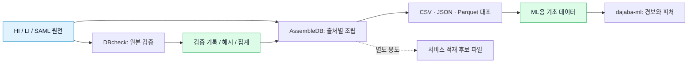
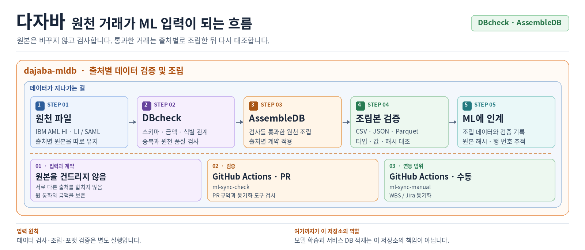
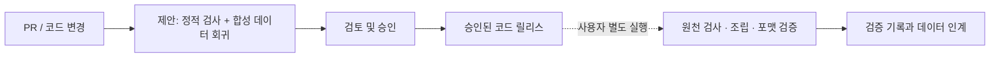

# dajaba-mldb

**원천 데이터를 검증하고, ML이 읽을 수 있는 출처별 데이터로 조립합니다.**

DBcheck와 AssembleDB의 출처별 검사 및 조립 파일 계약을 설명합니다. 서비스 DB의 원천 적재는 백엔드가 담당합니다.

## 이 저장소가 하는 일

- DBcheck: IBM AML HI·LI와 SAML-D의 스키마, 금액, 식별 관계, 중복을 출처별로 읽기 전용 검사합니다. 공개 설정 예제는 HI-Small·LI-Small·SAML-D를 사용합니다.
- AssembleDB: 검사된 원천을 출처별로 조립하고 CSV·JSON·Parquet 출력의 내용과 계약을 검증합니다.
- 원본 파일 해시와 행 번호를 보존해 후속 ML 결과를 원천까지 추적합니다.
- 모델 학습과 실제 서비스 DB 적재는 수행하지 않습니다.

## 데이터 흐름



서비스·STR 시연은 백엔드가 HI-Small 원천 파일을 서비스 DB에 적재한 뒤 경보를 만들고 근거 거래를 조회합니다. 무작위 10,000행은 전체 이력이나 룰 탐지 재현을 보장하지 않습니다.

## 폴더별 역할

| 폴더 | 내용 |
| --- | --- |
| DBcheck/src/dbcheck | 원천 계약, 품질 검사, 보고서 |
| DBcheck/configs | 원천 위치와 검사 설정 |
| DBcheck/tests | 작은 합성 데이터 기반 회귀 검사 |
| AssembleDB/src/assemble_db | 조립, 차원 스키마, 출력 계약과 재검증 |
| AssembleDB/configs | 조립과 선택 범위 설정 |
| AssembleDB/tests | 정밀도·ID·조립·재로딩 검사 |
| docs | 공개 가능한 계약·사용법·아키텍처만 선별 |

## 원칙

1. HI·LI·SAML을 하나의 거래망으로 합치지 않습니다.
2. 원본 금액·통화를 보존하고 서로 다른 통화를 합산하거나 임의 환산하지 않습니다.
3. 서비스 후보 v4는 numeric(20,6) 표현 가능성을 검사하며, 실제 DB 적재 성공과 구분합니다.
4. 학습 UID·후보 ID·원본 행 번호·백엔드 거래 ID는 서로 다른 식별자입니다.
5. 원본 라벨은 별도 관리하며 모델 입력에 섞지 않습니다.

## 환경과 실행 준비

공통 개발 환경은 Python 3.12를 기준으로 맞춥니다. DBcheck는 PyArrow·Polars, AssembleDB는 DBcheck에 의존합니다. 각 패키지의 pyproject.toml을 기준으로 설치 순서를 맞춥니다.

새 가상환경에 두 패키지를 함께 설치하고 작업용 설정 사본을 구성합니다. [설치 및 데이터 인계](docs/final-data-handoff.md)를 참고합니다.

## 시스템 아키텍처



### CI/CD 구조

원격 `ml-sync-check`는 PR 규약과 동기화 도구를 검사하고, `ml-sync-manual`은 수동 WBS/Jira 동기화를 담당한다. 원천 검사와 파일 조립·검증은 [로컬 데이터 인계 절차](docs/final-data-handoff.md)를 따른다.

<!-- cicd-pipeline-image: mldb-cicd-pipeline -->
[이전 CI/CD 그림](docs/images/mldb-cicd-pipeline.png)

[이전 CI/CD 그림의 SVG 원본](docs/images/mldb-cicd-pipeline.svg)

이전 CI/CD 그림의 파란 실선은 현재 로컬에서 확인한 정의·구현, 초록 점선은 CI/CD 제안, 주황 점선은 사용자 실행·별도 승인 또는 후속 검증 단계입니다. 워크플로 정의와 실제 실행 성공은 구분하며, 미확정 배포 기술은 로고로 단정하지 않습니다. 아래 Mermaid와 기존 설명은 편집 가능한 요약으로 보존합니다.
<!-- /cicd-pipeline-image -->



- 현재 원격 저장소의 ml-sync-check / ml-sync-manual은 상태 동기화 도구용입니다. 데이터 파이프라인 CI/CD와 다릅니다.
- 위 데이터 코드 CI는 제안 단계입니다. 기존 워크플로를 덮어쓰지 않습니다.
- 전체 원천 데이터 실행, 운영 DB 적재, 자동 배포는 PR 검사에 넣지 않습니다.
- 원천·산출물·가상환경·개인 문서·비밀정보를 Git에 넣지 않습니다.

## 연관 저장소

[다자바 ML](https://github.com/dajaba-team/dajaba-ml)에서 경보 생성, 피처, 시간순 분할, 학습과 평가를 다룹니다.

## 로컬 작업 공간과 공개 경계

이 저장소의 공개 코드 범위는 DBcheck와 AssembleDB입니다. 조립 파일의 소비, 학습용 경보·피처 생성과 모델 학습은 ML 측 작업입니다.

## 설치와 수동 검증

Python 3.12 가상환경을 활성화하고 저장소 루트에서 실행합니다.

```sh
python -m pip install ./DBcheck ./AssembleDB pytest
python -m pip check
python -m pytest DBcheck/tests AssembleDB/tests -q
```

출처별 조립·검증·인계 명령은 [데이터 인계 절차](docs/final-data-handoff.md)에 있습니다.

## 기존 작업과 이력 보존

이번 갱신 전의 미커밋 README 및 하위 ML README는 원문 그대로 로컬 artifacts의 repo-docs-before 기록에 보존했습니다. 원래의 원본 보존·출처 격리·거래 ID 구분·사용자 실행 원칙을 유지합니다. 11/2 기록의 ‘룰 미구현/합의 대기’는 현재 상태가 아니므로 본문에서 최신 구현과 분리했습니다. 이전 테스트 수나 전체 원천 검증 결과를 이번 검사 결과로 주장하지 않습니다.
