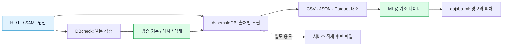
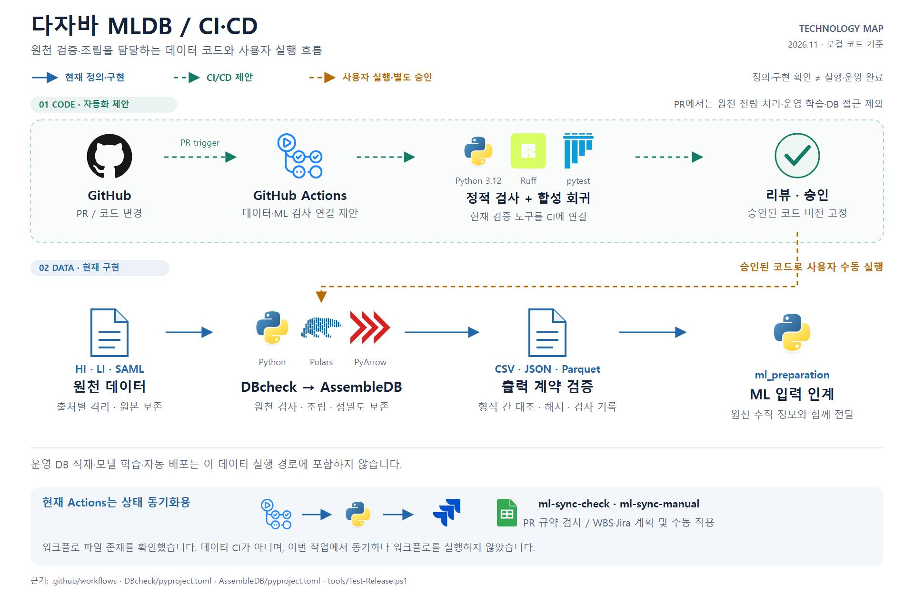
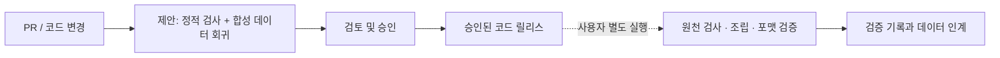

# dajaba-mldb

**원천 데이터를 검증하고, ML이 읽을 수 있는 출처별 데이터로 조립합니다.**

> 2026-11-09 KST 갱신. 현재 로컬 작업 폴더를 기준으로 설명합니다. GitHub 게시·새 환경 설치·이번 리팩터링의 실행 검증은 별도 단계입니다.

## 이 저장소가 하는 일

- DBcheck: HI-Small·LI-Small·SAML-D의 스키마, 금액, 식별 관계, 중복과 원천 품질을 읽기 전용으로 검사합니다.
- AssembleDB: 검사된 원천을 출처별로 조립하고 CSV·JSON·Parquet 출력의 내용과 계약을 검증합니다.
- 원본 파일 해시와 행 번호를 보존해 후속 ML 결과를 원천까지 추적합니다.
- 모델 학습과 실제 서비스 DB 적재는 수행하지 않습니다.

## 데이터 흐름



서비스 후보 파일은 운영 DB가 아닙니다. 현재 서비스·STR 시연은 백엔드의 HI-Small 전체 적재 DB에서 경보를 만들고 필요한 근거를 추출하는 방향을 협의 중입니다. 무작위 10,000행은 전체 이력이나 룰 탐지 재현을 보장하지 않습니다.

## 폴더별 역할

| 폴더 | 내용 |
| --- | --- |
| DBcheck/src/dbcheck | 원천 계약, 품질 검사, 보고서 |
| DBcheck/configs | 원천 위치와 검사 설정 |
| DBcheck/tests | 작은 합성 데이터 기반 회귀 검사 |
| AssembleDB/src/assemble_db | 조립, 차원 스키마, 출력 계약과 재검증 |
| AssembleDB/configs | 조립과 선택 범위 설정 |
| AssembleDB/tests | 정밀도·ID·조립·재로딩 검사 |
| docs | 공개 가능한 계약·사용법·아키텍처만 선별 |

## 원칙

1. HI·LI·SAML을 하나의 거래망으로 합치지 않습니다.
2. 원본 금액·통화를 보존하고 서로 다른 통화를 합산하거나 임의 환산하지 않습니다.
3. 서비스 후보 v4는 numeric(20,6) 표현 가능성을 검사하며, 실제 DB 적재 성공과 구분합니다.
4. 학습 UID·후보 ID·원본 행 번호·백엔드 거래 ID는 서로 다른 식별자입니다.
5. 원본 라벨은 별도 관리하며 모델 입력에 섞지 않습니다.

## 환경과 실행 준비

공통 개발 환경은 Python 3.12를 기준으로 맞춥니다. DBcheck는 PyArrow·Polars, AssembleDB는 DBcheck에 의존합니다. 각 패키지의 pyproject.toml을 기준으로 설치 순서를 맞춥니다.

현재는 기존 로컬 작업 공간에서 실행하는 구조입니다. 독립 저장소 설치 명령은 설정 경로와 공유 도구를 정리한 뒤 검증해 추가합니다. 옛 실행 폴더가 포함된 예제를 그대로 실행하지 마세요.

## CI/CD 구조

<!-- cicd-pipeline-image: mldb-cicd-pipeline -->


[확대 가능한 SVG 원본](docs/images/mldb-cicd-pipeline.svg)

실제 기술·라이브러리 로고로 구성한 그림입니다. 파란 실선은 현재 로컬에서 확인한 정의·구현, 초록 점선은 CI/CD 제안, 주황 점선은 사용자 실행·별도 승인 또는 후속 검증 단계입니다. 워크플로 정의와 실제 실행 성공은 구분하며, 미확정 배포 기술은 로고로 단정하지 않습니다. 아래 Mermaid와 기존 설명은 편집 가능한 요약으로 보존합니다.
<!-- /cicd-pipeline-image -->



- 현재 원격 저장소의 ml-sync-check / ml-sync-manual은 상태 동기화 도구용입니다. 데이터 파이프라인 CI/CD와 다릅니다.
- 위 데이터 코드 CI는 제안 단계입니다. 기존 워크플로를 덮어쓰지 않습니다.
- 전체 원천 데이터 실행, 운영 DB 적재, 자동 배포는 PR 검사에 넣지 않습니다.
- 원천·산출물·가상환경·개인 문서·비밀정보를 Git에 넣지 않습니다.

## 연관 저장소

[다자바 ML](https://github.com/dajaba-team/dajaba-ml)에서 경보 생성, 피처, 시간순 분할, 학습과 평가를 다룹니다.

## 로컬 작업 공간과 공개 경계

이 작업 공간의 DBcheck·AssembleDB가 MLDB 공개 대상입니다. ml_preparation은 같은 로컬 작업 공간에 있지만 ML 저장소용 코드입니다. 원본이나 코드를 이동하지 않습니다. 현재 ML의 별도 Git 경계는 아직 연결하지 않았습니다. staging 준비본은 업로드 원본으로 사용하지 않습니다.

작은 회귀 검사는 프로젝트 루트에서 .venv의 Python을 사용해 tools/Test-Release.ps1로 사용자가 직접 실행합니다. 로그와 summary.json은 artifacts/release-check-*에 남습니다. 이 도구는 원천 전처리나 운영 모델 학습을 실행하지 않습니다. 합성 데이터 기반 검사 내부 학습은 포함될 수 있습니다.

## 설치와 수동 검증

기존 환경을 재생성하지 않습니다. Python 3.12 환경이 이미 있다면 필요할 때만 로컬 패키지를 설치합니다. 아래 설치 명령도 이번 작업에서는 실행하지 않았습니다.

```powershell
# 실제 프로젝트 루트에서 사용자가 실행
.\.venv\Scripts\python.exe -m pip install -e .\DBcheck -e .\AssembleDB -e '.\ml_preparation[training]'
.\.venv\Scripts\python.exe -m pip install 'pytest>=8,<10' 'ruff>=0.9,<1'
```

검증만 실행하려면 설치와 구분해서 아래를 실행합니다.

```powershell
Set-Location 'C:\Dajaba'
& .\tools\Test-Release.ps1
```

마지막 EVIDENCE_DIRECTORY 안의 ruff.log, mldb_tests.log, ml_tests.log와 summary.json을 확인합니다. 실패하면 후속 단계는 실행하지 않습니다. 기존 run, 입력 인덱스, DB, 운영 모델은 변경하지 않습니다. 테스트 자체는 임시 합성 파일을 만들 수 있습니다.

## 기존 작업과 이력 보존

이번 갱신 전의 미커밋 README 및 하위 ML README는 원문 그대로 로컬 artifacts의 repo-docs-before 기록에 보존했습니다. 원래의 원본 보존·출처 격리·거래 ID 구분·사용자 실행 원칙을 유지합니다. 11/2 기록의 ‘룰 미구현/합의 대기’는 현재 상태가 아니므로 본문에서 최신 구현과 분리했습니다. 이전 테스트 수나 전체 원천 검증 결과를 이번 검사 결과로 주장하지 않습니다.